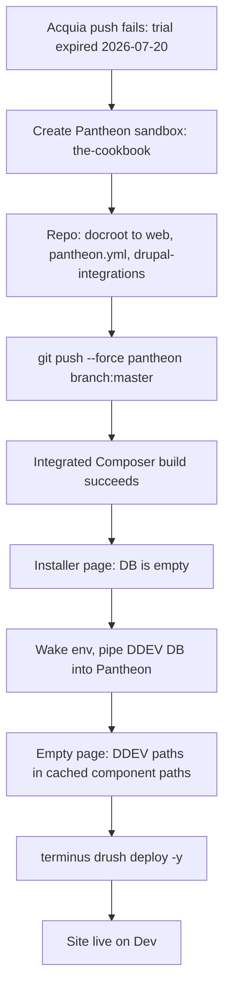

# Hosting on Pantheon — what we executed

> Branch: `feat/pantheon-hosting` (commit `ad21c90`, pushed to Pantheon, not yet merged on GitHub) · Last updated: 2026-10-08
>
> The record of moving this site from Acquia Cloud to a Pantheon Sandbox after the Acquia trial expired. It is the **outcome** companion to [Day 3 §6](../objectives/day3-acquia-cloud-devops.md#6-push-flavorful-to-acquia-cloud-hands-on--what-actually-worked), which plans an Acquia deploy, and the successor to [`acquia-deployment-guide.md`](acquia-deployment-guide.md), which stays as the record of that first deploy. Day 3 already covers the concepts (config moves up and content moves down, `updb → cim → cr`, Composer-managed code). This doc covers only what Pantheon changed.
>
> **Status: Dev is live.** <https://dev-the-cookbook.pantheonsite.io> serves the real site: `/`, `/recipes`, `/articles` and `/user/login` return 200, and `config:status` reports no differences. Still open: local development settings carried over in the database, the uploaded-files copy is unconfirmed, the branch is not on GitHub `master`, and there is no Solr on Pantheon yet (see [Still open](#still-open)).

---

## Why we moved

The redeploy to Acquia failed with `Permission denied (publickey)`, but the key was not the problem. The SSH config offered the right RSA key, and its fingerprint matched the key registered on the account. The real cause showed in `acli api:subscriptions:list`: **"Trial: foodrecipes" expired on 2026-07-20**, and the application went with it. The account now sees zero applications, and the old Dev URL returns 404.

We chose a Pantheon **Sandbox** because it does not expire on a date. An idle sandbox sleeps (and is eventually frozen), but it is never deleted, and it wakes on the first request.

| | |
|---|---|
| Site | `the-cookbook` (UUID `04c4fe6e-5f26-4b55-beb5-bc800de9eadc`) |
| Upstream | `drupal-composer-managed` |
| Plan | Sandbox (free) |
| Dev URL | <https://dev-the-cookbook.pantheonsite.io> |
| Dev mode | Git, PHP 8.3, MariaDB 10.6 |

---

## Objective → outcome map

| Objective (Day 3 §6) | What shipped on Pantheon | Status |
|---|---|---|
| [§6.1](../objectives/day3-acquia-cloud-devops.md#61-the-one-idea-that-changes-everything) Build an artifact that bundles `vendor/` | Not needed. Pantheon's Integrated Composer runs `composer install` on every push, so `vendor/`, core and contrib stay gitignored | deviated (simpler) |
| [§6.3](../objectives/day3-acquia-cloud-devops.md#63-ssh-key--it-must-be-rsa-not-ed25519) RSA SSH key | Reused the same `~/.ssh/acquia_key`, which was already registered on Pantheon. It needed its own `Host *.drush.in` block | done |
| [§6.4](../objectives/day3-acquia-cloud-devops.md#64-authenticate-acli--discover-the-environment) Authenticate the CLI | `terminus` replaces `acli`; it was already installed and logged in | done |
| [§6.5](../objectives/day3-acquia-cloud-devops.md#65-prepare-the-codebase-three-fixes-that-each-cost-a-debugging-cycle) Prepare the codebase | Docroot moved back to `web/`, plus `pantheon.yml` and `drupal-integrations` | deviated (reversed) |
| [§6.6](../objectives/day3-acquia-cloud-devops.md#66-build--push-the-artifact)–[§6.7](../objectives/day3-acquia-cloud-devops.md#67-activate-it--the-deploy-is-two-phase) Push, then activate | One step: a push to Pantheon `master` is a deploy to Dev | done |
| [§6.8](../objectives/day3-acquia-cloud-devops.md#68-load-a-database--finalise) Load a database and finalise | Local DB piped from the DDEV container, then `drush deploy` | done |
| [§6.9](../objectives/day3-acquia-cloud-devops.md#69-clear-varnish--verify) Clear the edge cache and verify | No edge purge was run. `drush deploy`'s cache rebuild was enough, and the routes were checked with curl | done |

---

## Deviation log

| Divergence from the Acquia path | Why | What we did |
|---|---|---|
| Docroot `docroot/` → `web/` | Pantheon only serves a nested docroot named `web` (`web_docroot: true`). This reverses Acquia step 5 | Moved with `mv` (not `git mv`) so ignored core, contrib and files moved too. Updated composer installer paths, `.gitignore`, `.ddev/config.yaml`, `phpcs.xml.dist`, `phpstan*.neon`, CI and `scripts/contrast.py` |
| No artifact, no code-switch | Integrated Composer builds on push (`build_step: true`), and `master` is the Dev environment | `git push pantheon <branch>:master` |
| First push was a `--force` | Pantheon's repo held the starter code, whose history is unrelated to ours | Force-pushed once, replacing the starter. Later pushes are plain |
| `pantheon.yml` carries upstream values | The force-push removed the starter's `pantheon.upstream.yml` | Copied `enforce_https` and `protected_web_paths` into our `pantheon.yml` |
| `drupal/core` 11.4.1 → 11.4.8 | Composer 2.10 refuses to resolve anything while the locked core has published advisories, so `drupal-integrations` could not be added | A patch-level update within 11.4 |
| `drupal/devel` moved from `require-dev` to `require` | `devel_generate` is enabled in `core.extension`, and Pantheon builds without dev packages. Config import would fail on a missing module | Moved to `require`. Only `devel_generate` is enabled, not `devel` |
| Scaffold limited | Core 11.4.8's scaffold rewrote `.gitattributes` (dropping our `*.py` and `*.neon` LF rules) and wrote a `web/.gitignore` that untracked `web/autoload*.php` | Set `"[project-root]/.gitattributes": false` in the scaffold `file-mapping`, and `"gitignore": false` |
| DB copied through the DDEV container | The host has no `mysql` client | `ddev exec "mysqldump … \| <terminus mysql_command>"` |

---

## The sequence



### 1. One-time machine setup

`terminus` was already installed (`/opt/homebrew/bin/terminus`) and logged in. The RSA key from the Acquia setup was already registered on Pantheon (same MD5 fingerprint, `01:af:3d:…:42:d6`), but SSH never offered it. `*.drush.in` had no `Host` block, so SSH tried only the default `id_*` files. Fix in `~/.ssh/config`, **above** `Host *`:

```ssh-config
Host *.drush.in
  IdentityFile ~/.ssh/acquia_key
  IdentitiesOnly yes
  IdentityAgent none
```

### 2. Repo changes (commit `ad21c90`)

Deltas only. Everything else is a pure `docroot/ → web/` rename (296 files).

`pantheon.yml` (new):

```yaml
api_version: 1
web_docroot: true
php_version: 8.3
database:
  version: 10.6
build_step: true
enforce_https: transitional
protected_web_paths:
  - /private/
  - /sites/default/files/private/
  - /sites/default/files/config/
```

`settings.php` gains one block. It is guarded so DDEV is unaffected, and our earlier `config_sync_directory = '../config/sync'` still wins, because `settings.pantheon.php` only sets that value when it is empty:

```php
if (isset($_ENV['PANTHEON_ENVIRONMENT']) && file_exists(__DIR__ . '/settings.pantheon.php')) {
  include __DIR__ . '/settings.pantheon.php';
}
```

`composer.json` changes:

- **New packages in `require`:** `pantheon-systems/drupal-integrations: ^11`, and `drupal/devel`, moved there from `require-dev`.
- **Scaffold settings:**
  - `allowed-packages` lists `pantheon-systems/drupal-integrations`.
  - `file-mapping` stops the scaffold writing `.gitattributes`.
  - `"gitignore": false` stops it writing `.gitignore` files.

`.gitignore` ignores the two files that the scaffold writes on every install, including Pantheon's build: `settings.pantheon.php` and `default.services.pantheon.preproduction.yml`.

Verified locally before pushing: the four routes return 200 on 11.4.8, and `phpcs` and `phpstan` pass on the new paths.

### 3. Connect and push

```bash
terminus connection:info the-cookbook.dev --field=git_url
git remote add pantheon ssh://codeserver.dev.<UUID>@codeserver.dev.<UUID>.drush.in:2222/~/repository.git
git push --force pantheon feat/pantheon-hosting:master   # first push only
```

Pantheon ran "Sync code on dev" and it succeeded. `drush status` then showed Drupal 11.4.8 at `/code/web`.

### 4. Database

```bash
terminus env:wake the-cookbook.dev
MYSQL_CMD=$(terminus connection:info the-cookbook.dev --field=mysql_command)
ddev exec "mysqldump --single-transaction db | $MYSQL_CMD"
terminus drush the-cookbook.dev -- deploy -y
```

---

## Issues we hit → root cause → fix

| # | Symptom | Root cause | Fix |
|---|---|---|---|
| 1 | Acquia `push:artifact`: `Permission denied (publickey)` | The trial subscription expired on 2026-07-20 and the app no longer exists. The key was fine | Moved hosts. Check `acli api:subscriptions:list` before debugging keys |
| 2 | Cloning Pantheon's repo: `Could not read from remote repository` | No `Host *.drush.in` block, so SSH never offered `acquia_key` | Added the block (step 1) |
| 3 | `composer require` failed with pages of `SA-CORE-…` advisories | The locked core 11.4.1 had published advisories, which Composer 2.10 blocks during resolution | Updated `drupal/core-*` to 11.4.8 |
| 4 | `drupal/devel` disappeared from disk | A failed `require` rolled `composer.json` back to the state after `remove --dev --no-update`, which listed devel nowhere, so the next `update` uninstalled it | Re-ran `composer require drupal/devel:^5.5 …` |
| 5 | `.gitattributes` changed, CRLF warnings appeared | The 11.4.8 scaffold overwrote it | Scaffold `file-mapping: false`, then restored the file |
| 6 | `web/autoload*.php` became gitignored | The scaffold writes a `web/.gitignore` when the folder is untracked (it was, right after the `mv`) | `"gitignore": false`; deleted `web/.gitignore` |
| 7 | Pantheon URL showed the Drupal installer | The code was deployed but the DB was empty | Imported the DB (step 4) |
| 8 | Host: `zsh: command not found: mysql` | The Mac has no MySQL client | Ran the client inside the DDEV container |
| 9 | `ERROR 2002 … (115)` to `dbserver…:13961` | The sandbox Dev environment was asleep | `terminus env:wake the-cookbook.dev`, then retried |
| 10 | Page rendered dark and empty, admin sidebar had no labels | The dump included cache tables holding DDEV paths (`/var/www/html/web/…`). The watchdog showed `ComponentLoader` failing to open `site-footer.twig` there. Pantheon's code is at `/code/web/…` | `drush deploy`, whose final cache rebuild replaced the paths |
| 11 | `FILE NAME SUGGESTIONS` comments in Pantheon's HTML | Local `twig_debug` and `twig_cache_disable` live in the `development_settings` key-value store, which is in the database | Still open (see below) |

---

## Key learnings

- **An "SSH key" error from a host can mean "nothing is there".** Acquia gives the same `publickey` denial whether the key is wrong or the app is gone. Check that the subscription or app exists before debugging keys.
- **A database dump carries more than content.** It also carries cache tables, which hold absolute paths from the old host, and settings stored in key-value, such as Twig debug. After any import, always run `drush deploy`. Better still, leave the `cache_*` tables out of the dump.
- **The docroot name is the host's decision.** Acquia wanted `docroot/` and Pantheon wants `web/`. Every move is a composer + gitignore + DDEV + linters + CI change.
- **Sandboxes sleep.** Wake the environment before any direct database or SSH work.
- **Scaffold changes with core.** A core patch release can rewrite project-root files. Opt them out in `file-mapping` once you have customised them.

---

## Still open

1. **Development settings on Pantheon.** Twig debug is on and the Twig cache is off, both copied from local:
   ```bash
   terminus drush the-cookbook.dev -- php:eval '\Drupal::keyValue("development_settings")->deleteMultiple(["twig_debug","twig_cache_disable"]);'
   terminus drush the-cookbook.dev -- cr
   ```
2. **Uploaded files.** Not confirmed copied. The command is `rsync -rlz --size-only --ipv4 -e 'ssh -p 2222' ./web/sites/default/files/. --temp-dir=~/tmp/ dev.<UUID>@appserver.dev.<UUID>.drush.in:files/`. Site Studio's generated assets live there too.
3. **GitHub.** `feat/pantheon-hosting` is on Pantheon only, and GitHub `master` still has `docroot/`. Once it is merged, deploy with a plain `git push pantheon master`.
4. **Solr.** The `search_api.server.solr` config points at DDEV's Solr. Recipe search on Pantheon needs `search_api_pantheon` and `search: { version: 8 }` in `pantheon.yml`, if the plan includes Pantheon Search.
5. **Leftover config difference.** `config:status` locally (not on Pantheon) shows four `search_api_solr.solr_field_type.*` items as Different, `''` versus `"\n"` for empty word lists. This doesn't affect behaviour, and it is unrelated to the move.

---

## Command cheat-sheet

```bash
# --- deploy (after merge to GitHub master) ---
git push pantheon master
terminus drush the-cookbook.dev -- deploy -y

# --- database refresh, local -> Dev (skip caches) ---
terminus env:wake the-cookbook.dev
MYSQL_CMD=$(terminus connection:info the-cookbook.dev --field=mysql_command)
ddev exec "mysqldump --single-transaction db $(printf -- '--ignore-table=db.%s ' cache_bootstrap cache_config cache_container cache_data cache_default cache_discovery cache_dynamic_page_cache cache_entity cache_menu cache_page cache_render) | $MYSQL_CMD"
terminus drush the-cookbook.dev -- deploy -y

# --- inspect ---
terminus workflow:list the-cookbook
terminus drush the-cookbook.dev -- status
terminus drush the-cookbook.dev -- watchdog:show --count=15 --severity-min=Warning
```

*The site name, UUID and URLs are this project's Dev environment and are not secrets. The database password comes from `terminus connection:info` at run time and is never written down.*
